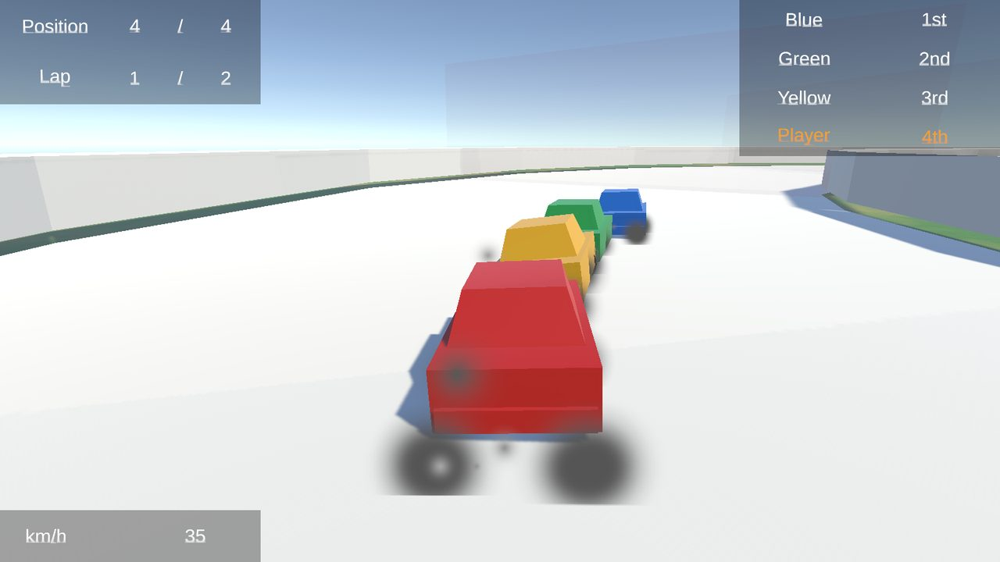
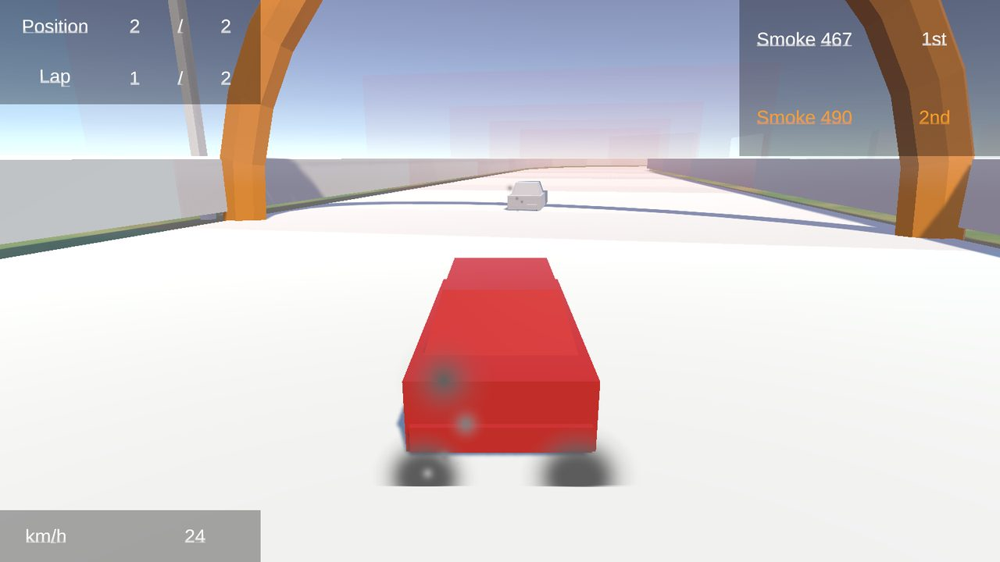
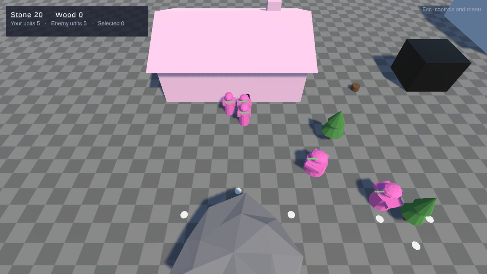
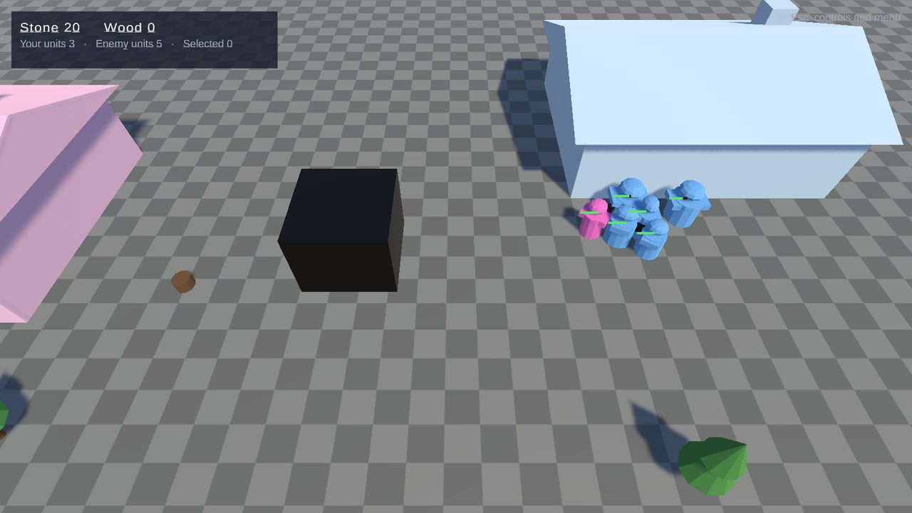
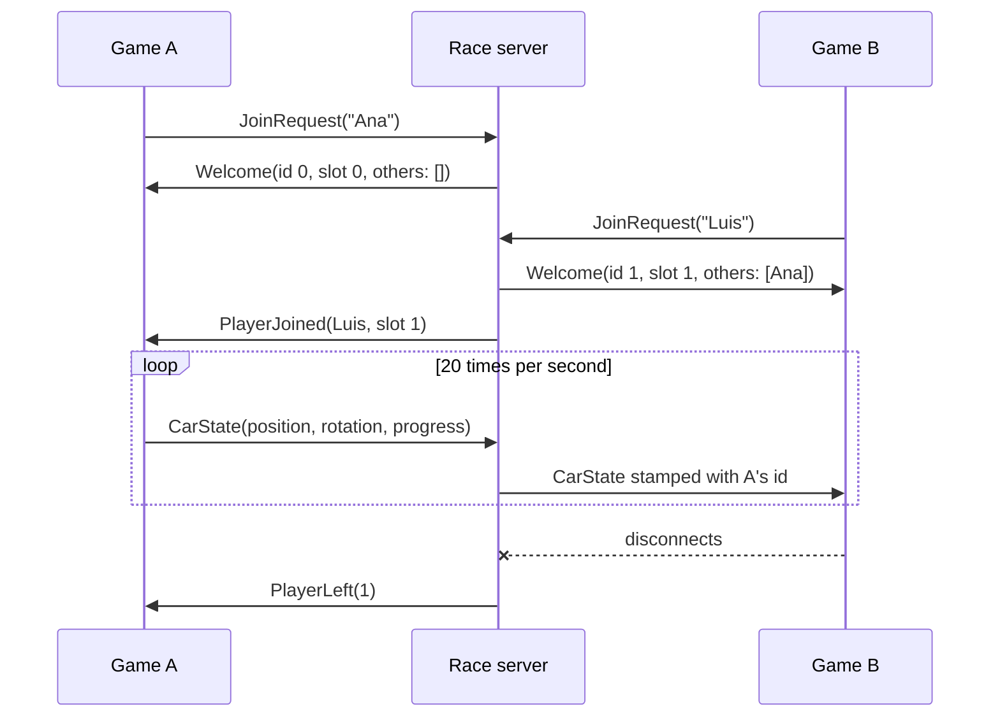

# Unity Lab

[](https://github.com/miguelrg14/Unity-Lab/actions/workflows/ci.yml)
[](https://github.com/miguelrg14/Unity-Lab/releases)


[](LICENSE)

Two gameplay programming prototypes in one Unity 6 project, plus the dedicated server that powers the online races:

- **Racing**: physics cars on WheelColliders, AI drivers that follow the racing line and avoid obstacles, and **online multiplayer** over TCP against a .NET 8 server.
- **RTS**: box selection and orders, units driven by state machines, a vision system built on a distance matrix, resource harvesting with queues, and an AI opponent.

**▶ [Play it in the browser](https://miguelrg14.github.io/Unity-Lab/)** (racing against the AI and the RTS; online races need the desktop build) · **[Download the latest release](https://github.com/miguelrg14/Unity-Lab/releases/latest)**

| Racing vs AI | Online race (two game instances and the real server) |
|---|---|
|  |  |
| **RTS: harvesters working and units training** | **RTS: the armies meet** |
|  |  |

<sub>Captured automatically by the CI smoke test on a headless Linux build. Main menu: [docs/screenshots/main-menu.jpg](docs/screenshots/main-menu.jpg).</sub>

## Projects

| Project | What it shows | Code |
|---|---|---|
| **Racing vs AI** | WheelCollider car with drivetrain options, anti-roll bar, skid smoke and sound, flip recovery. Three AI drivers steer towards their next checkpoint, brake before corners and dodge obstacles with raycast whiskers. Ordered checkpoints, laps and live standings. | [`Racing/Scripts`](UnityProject/Assets/_Project/Racing/Scripts) |
| **Racing online** | Up to four players. A binary, length-prefixed protocol shared by client and server, a networking thread feeding Unity's main thread through a queue, and remote cars that interpolate and extrapolate between updates. | [`Racing/Scripts/Protocol`](UnityProject/Assets/_Project/Racing/Scripts/Protocol), [`Online`](UnityProject/Assets/_Project/Racing/Scripts/Runtime/Online) |
| **Race server** | .NET 8 console server: async accept/receive loops, one bounded send queue per client, slot assignment, unique nicknames and server-side identities. Runs with Docker Compose. | [`Server`](Server) |
| **RTS skirmish** | Box selection, move/attack/harvest orders, melee, artillery and harvester units, a vision matrix that notifies units when enemies enter or leave their range, harvesting spots with a waiting queue, resources and unit costs, and an AI commander. | [`RTS/Scripts`](UnityProject/Assets/_Project/RTS/Scripts) |

## Design notes

### Online races



- **Shared protocol.** [`Protocol`](UnityProject/Assets/_Project/Racing/Scripts/Protocol) has no Unity dependency. Unity compiles it as an assembly and the server compiles the same files, so both ends always agree on the format.
- **Framing.** TCP is a byte stream, so every message is `[uint16 length][type][fields]`. [`FrameReader`](UnityProject/Assets/_Project/Racing/Scripts/Protocol/FrameReader.cs) rebuilds whole frames from partial or merged reads and rejects empty or oversized frames before buffering them.
- **Binary fields.** Floats travel as IEEE-754 values: exact, and independent of the machine's culture (no `1,5` vs `1.5`). NaN, truncated payloads and invalid UTF-8 are rejected.
- **Server authority over identity.** The server assigns ids and grid slots and overwrites the sender id of every `CarState`, so a client can only move its own car. Each car is simulated by its owner and the server relays it, which is enough for a non-competitive prototype.
- **Concurrency.** Each client has a receive task and a send task fed by a bounded channel. A slow client is dropped instead of slowing down the others, and the shared player list is only touched under one lock.
- **Unity side.** [`RaceClient`](UnityProject/Assets/_Project/Racing/Scripts/Protocol/RaceClient.cs) connects asynchronously and reads on a background thread into a concurrent queue. [`OnlineRaceManager`](UnityProject/Assets/_Project/Racing/Scripts/Runtime/Online/OnlineRaceManager.cs) consumes it on the main thread. [`RemoteCar`](UnityProject/Assets/_Project/Racing/Scripts/Runtime/Online/RemoteCar.cs) moves towards the last state, extrapolating with the measured velocity for up to 250 ms.

### Racing

- **Checkpoints in order.** [`RaceProgress`](UnityProject/Assets/_Project/Racing/Scripts/Core/RaceProgress.cs) only accepts the next checkpoint, which rules out shortcuts and driving backwards. Crossing the start line again after every other checkpoint completes a lap.
- **Standings.** [`RaceStandings`](UnityProject/Assets/_Project/Racing/Scripts/Core/RaceStandings.cs) ranks finished cars by time, the rest by checkpoints passed, and breaks ties by distance to the next checkpoint.
- **AI driver.** [`AICarDriver`](UnityProject/Assets/_Project/Racing/Scripts/Runtime/AI/AICarDriver.cs) steers by the angle to its next checkpoint and brakes in proportion to speed and corner sharpness. Six whiskers produce an avoidance correction that is recomputed every step, and a stuck car is put back on the track.
- **Driver/vehicle split.** [`CarController`](UnityProject/Assets/_Project/Racing/Scripts/Runtime/Cars/CarController.cs) only simulates the car. The player, the AI or the automated tests drive it through `SetInputs`.

### RTS

- **Vision matrix.** [`VisionMatrix`](UnityProject/Assets/_Project/RTS/Scripts/Core/VisionMatrix.cs) keeps the squared distance between every unit of army A (rows) and army B (columns). Each pair is computed once per frame for both sides, allies are never compared, and a per-axis check skips pairs that are clearly out of range before the exact distance. Units only receive *entered* and *left* events instead of searching every frame.
- **Units.** [`Unit`](UnityProject/Assets/_Project/RTS/Scripts/Runtime/Units/Unit.cs) runs a state machine (Idle, GoingTo, Attacking, Dying) on a NavMesh agent. Artillery adds a second state machine (None, Alert, Shooting, Chasing) and checks line of sight against one visible enemy per frame, round-robin. Harvesters loop through walk, claim a spot or queue, harvest, deliver and return.
- **Harvest spots.** [`HarvestSpots`](UnityProject/Assets/_Project/RTS/Scripts/Core/HarvestSpots.cs) hands out a fixed ring of spots, first come first served. A freed spot goes straight to the first harvester waiting in the queue.
- **AI commander.** [`AiCommander`](UnityProject/Assets/_Project/RTS/Scripts/Runtime/Army/AiCommander.cs) plays its army through the same API as the player: it keeps two harvesters working, trains soldiers, defends its base and attacks in waves.

### Engine-free core

The rules above live in assemblies with `noEngineReferences`, so they are plain C#. The same NUnit test files run in Unity's Test Runner and with `dotnet test`, which takes a few seconds and needs no Unity licence.

## Running it

**In the browser:** [miguelrg14.github.io/Unity-Lab](https://miguelrg14.github.io/Unity-Lab/)

**Desktop build:** download `UnityLab-StandaloneWindows64.zip` or `UnityLab-StandaloneLinux64.zip` from the [latest release](https://github.com/miguelrg14/Unity-Lab/releases/latest).

**Online race:**

1. Start the server, either with `docker compose up` (from the repository root), with `dotnet run --project Server/src/RaceServer`, or with the `RaceServer` executable from the release.
2. In the game, choose **Racing - Online**, enter a nickname and the server's IP address (port `7777`), and connect. Repeat on other computers or with more copies of the game.

**From the source:** open `UnityProject` with Unity **6000.6.8f1** and play `Assets/_Project/Menu/Scenes/MainMenu.unity`.

### Controls

| Racing | | RTS | |
|---|---|---|---|
| W / S | Accelerate / reverse | Left click or drag | Select |
| A / D | Steer | Right click | Move, attack or harvest |
| Space | Brake | Base selected + A / S / D | Train melee / artillery / harvester |
| R | Reset the car on the track | Arrows or screen edge, wheel | Pan, zoom |
| G | Driver / chase camera | F1 / F2 | Unit states / vision matrix |
| Esc | Pause and controls | Esc | Pause and controls |

## Tests

| Suite | Runs with | Covers |
|---|---|---|
| [`Tests/EditMode`](UnityProject/Assets/_Project/Tests/EditMode) | Unity and `dotnet test` | Protocol encoding, framing of split, merged and malicious input, nicknames, race progress, standings, health, vision matrix, harvest spots, treasury, selection box |
| [`RaceServer.Tests`](Server/tests/RaceServer.Tests) | `dotnet test` | A real server on a free port with real clients: joining, slots, unique names, relaying with forced ids, disconnects, a full race, wrong protocol version, garbage data, join timeout, several clients sending at once |
| [`Tests/PlayMode`](UnityProject/Assets/_Project/Tests/PlayMode) | Unity | The real scenes: AI cars lapping the circuit, car reset, the online scene against a scripted server, training and moving units on the NavMesh, units seeing and fighting each other, a full AI-vs-AI skirmish, the menu and the pause overlay |
| [`Tests/Editor`](UnityProject/Assets/_Project/Tests/Editor) | Unity | The procedural meshes fit their target size and face outwards |
| Smoke test | CI | Plays the built Linux game headless: the menu, a race and an RTS skirmish, then two game instances racing online through the real server. The screenshots above come from this run. |

```bash
dotnet test Server/UnityLab.sln          # protocol, gameplay rules and server, no Unity needed
docker compose up -d && dotnet run --project Server/src/RaceSmokeTest   # server in Docker
```

[GitHub Actions](.github/workflows/ci.yml) runs all of the above on every push, builds Linux and WebGL players and deploys the WebGL build to Pages. Pushing a `v*` tag publishes a [release](.github/workflows/release.yml) with Windows, Linux and WebGL builds and the server for Windows and Linux.

## Repository layout

```
UnityProject/                 Unity 6 project
  Assets/_Project/
    Menu/                     main menu
    Racing/Scripts/Core       race rules (no Unity dependency)
    Racing/Scripts/Protocol   network protocol and client (no Unity dependency)
    Racing/Scripts/Runtime    cars, AI, race, HUD, online
    RTS/Scripts/Core          RTS rules (no Unity dependency)
    RTS/Scripts/Runtime       units, armies, AI commander, camera, HUD
    Shared/                   scene navigation, UI helpers, smoke test runner, generated art
    Tests/                    EditMode, PlayMode and Editor tests
    Editor/                   procedural meshes and the one-off project migration
Server/                       .NET solution: protocol and core libraries, race server, tests
tools/                        script that generates the ground texture and sound effects
docker-compose.yml            runs the race server
```

## Background

Both demos started as coursework for **Concurrent Programming** (4th year of the Game Design and Development degree at UDIT, 2023/24). The server, the distance matrix and the base structure of the RTS units, armies and camera, as well as the base car, wheel and camera scripts, were built in class following the lecturer's step-by-step guidance. The circuit model and the race logic, AI driver, online client, harvesting and resources were my own part of the assignments.

The project was later reworked into this repository: the two projects were merged into a single Unity 6 project; the code was rewritten in English with bug fixes; the protocol and server were redesigned; and the tests, CI, builds and documentation were added. Third-party models were replaced by procedural meshes, and the ground texture and sound effects are generated by [`tools/generate_assets.py`](tools/generate_assets.py), so everything in the repository can be redistributed under the [MIT licence](LICENSE).
